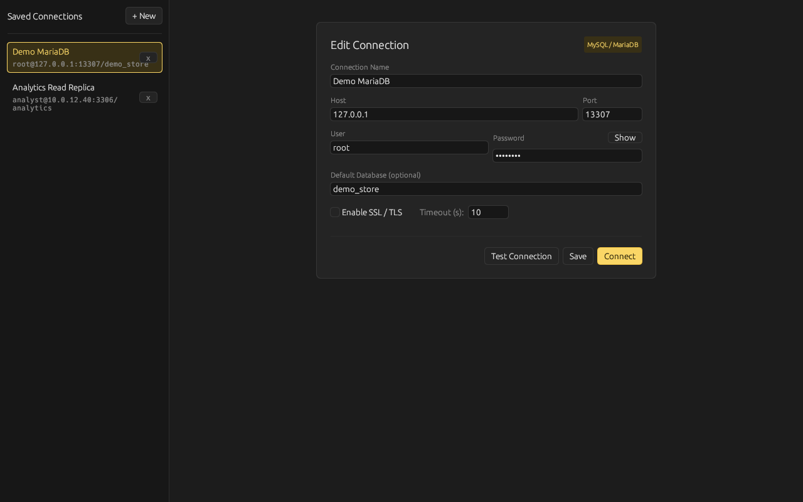
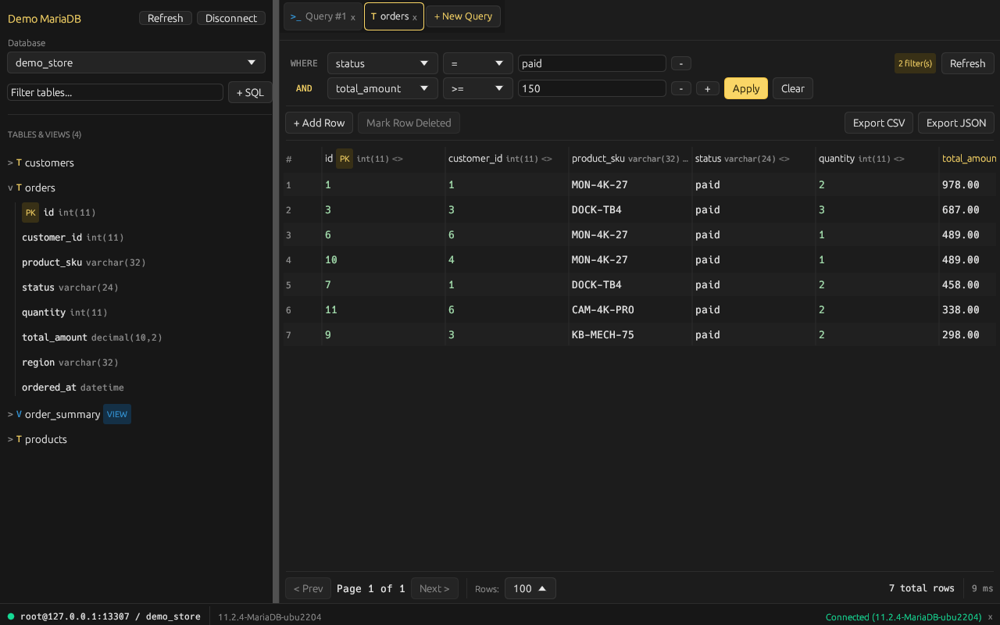
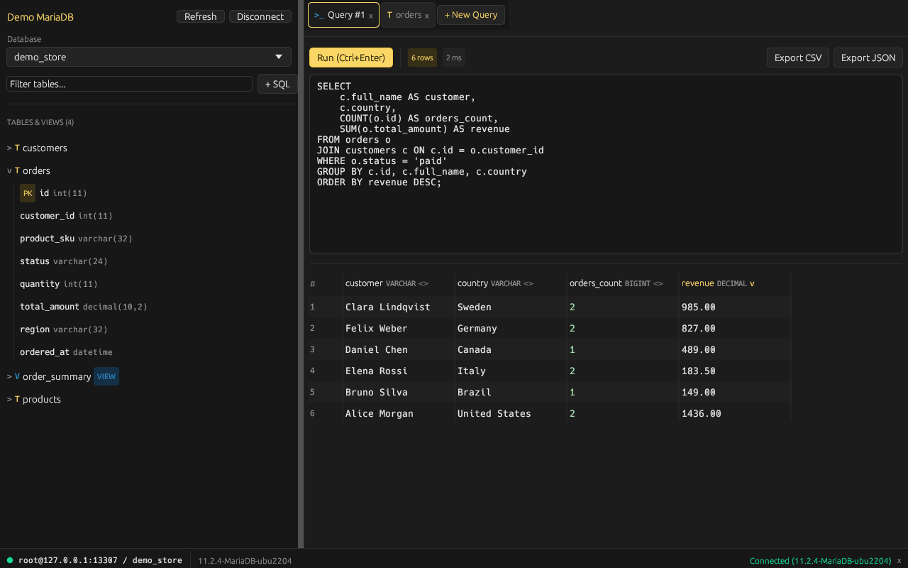

# rust-dbviewer

A fast, lightweight native desktop database viewer for MySQL and MariaDB, written in Rust with `eframe`/`egui`, `sqlx`, and `tokio`.

## Features

- **Saved Connections**: Manage multiple MySQL/MariaDB profiles (stored locally in `~/.config/rust-dbviewer/connections.json`), test connectivity before connecting, configure timeouts, and toggle TLS/SSL.
- **Schema Sidebar**: Switch databases, search tables and views with ranked exact/prefix/substring filtering, and inspect columns with primary key badges, data types, and nullability.
- **Multi-Tab SQL Editor**: Open multiple SQL query tabs, execute statements with `Ctrl+Enter`, cancel long-running queries (`KILL QUERY`), view execution time and row counts, and sort result sets client-side by any column.
- **Virtualized Paginated Data Grid**: Browse large tables smoothly with `egui_extras::TableBuilder` rendering only visible rows, configurable page sizes (`50`, `100`, `500`, `1000`), and server-side pagination.
- **Multi-AND Table Filtering**: Stack multiple `WHERE ... AND ...` filter conditions with operators (`=`, `!=`, `>`, `>=`, `<`, `<=`, `LIKE`, `NOT LIKE`, `IS NULL`, `IS NOT NULL`) that persist across pagination and sorting.
- **Column Sorting**: Click column headers to sort ascending or descending in both table views (server-side `ORDER BY`) and SQL query results (client-side permutation).
- **Inline Editing**: Double-click cells to edit, insert new rows, mark rows for deletion, and commit or discard batched changes in a single parameterized transaction (for tables with primary keys).
- **CSV & JSON Export**: Export table pages or SQL query results to RFC 4180 CSV or formatted JSON files.

## Screenshots

### Saved Connections


### Table Viewer (Multi-AND Filtering & Column Sorting)


### Multi-Tab SQL Editor


## Quick Install (Linux)

Install the latest release binary to `~/.local/bin/rust-dbviewer`, add `~/.local/bin` to your shell `PATH` if needed, and register the desktop application entry and icon:

```bash
curl -fsSL https://raw.githubusercontent.com/rafadepaula-olist/rust-dbviewer/main/install.sh | bash
```

Or run the script directly from a local clone:

```bash
./install.sh
```

## Prerequisites

- Stable Rust toolchain (`rustc` and `cargo` via [rustup](https://rustup.rs/))
- Linux desktop environment (X11 or Wayland with OpenGL support)
- Optional: Docker (for running integration and end-to-end tests against MariaDB)

## Build and Run

Build the optimized release binary:

```bash
cargo build --release
```

Run the application:

```bash
./target/release/rust-dbviewer
```

Or run directly in development mode:

```bash
cargo run
```

## Running Tests

Run unit, integration, and end-to-end tests:

```bash
cargo test
```

Run unit tests only (no Docker required):

```bash
cargo test --lib
```

Run Clippy lints:

```bash
cargo clippy --all-targets -- -D warnings
```
